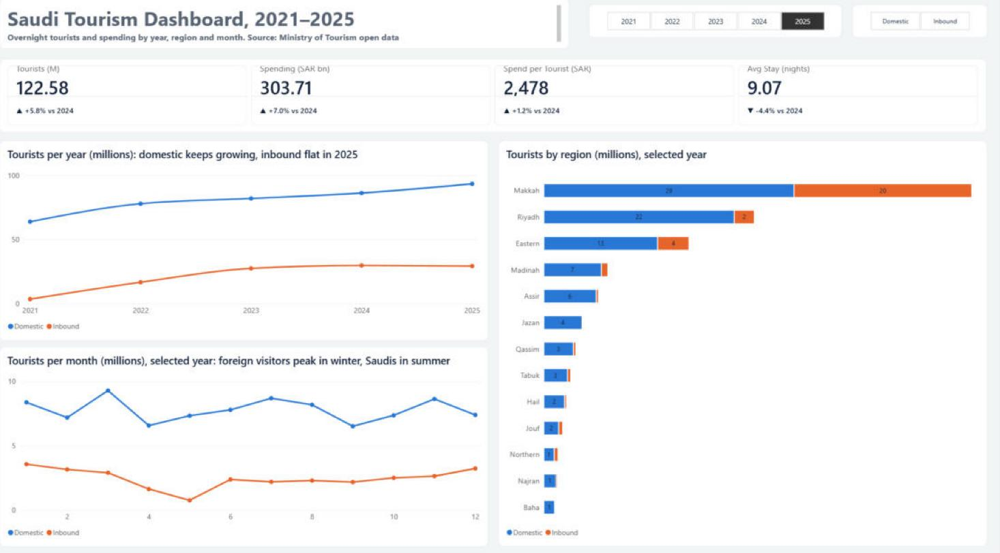
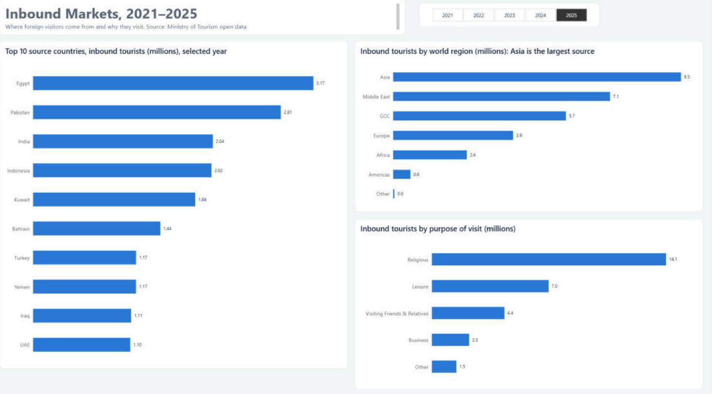
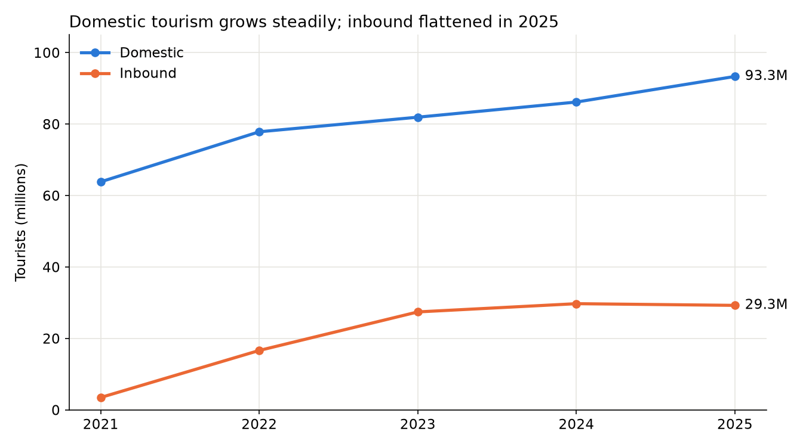
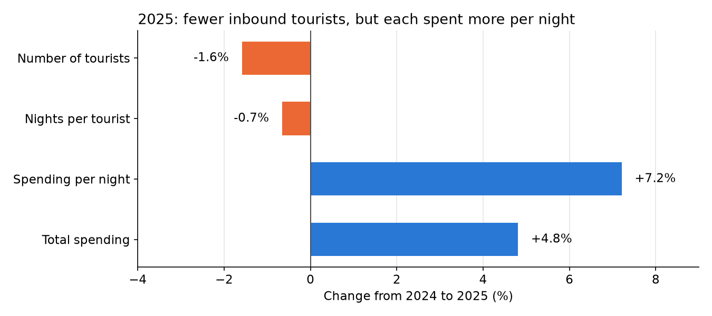
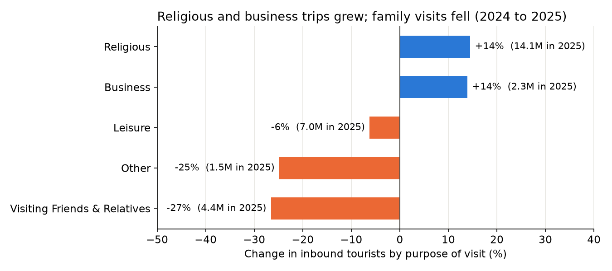
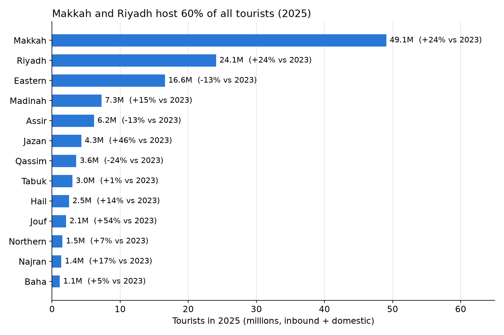
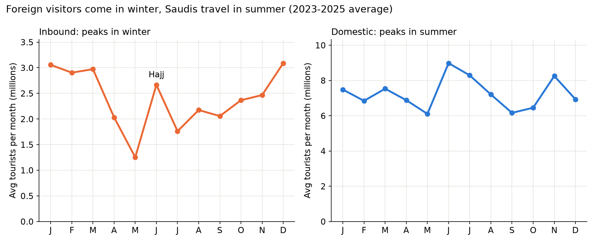
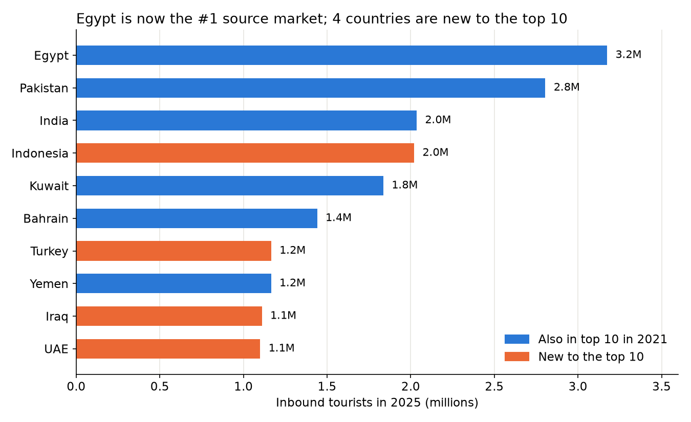

# Saudi Tourism Analysis (2021–2025)

An end-to-end data analysis of tourism in Saudi Arabia using the Ministry of Tourism's open data: cleaning in Python, analysis in SQL, charts in matplotlib, and an interactive Power BI dashboard.





The Power BI report has two pages (Overview, Inbound markets), a star-schema data model (years and tourism_types tables linked to every fact table), and DAX measures for year-over-year change.

## Questions

1. How have inbound and domestic tourism grown from 2021 to 2025?
2. Inbound tourists fell in 2025, but their spending rose. Why?
3. Which regions receive the most tourists, and which are growing fastest?
4. Which months are busiest for inbound and for domestic tourists?
5. Where do inbound tourists come from, and why do they visit?

## Key findings

**1. Domestic tourism grows steadily; inbound growth has flattened.**
Domestic tourists grew every year, from 63.8M in 2021 to 93.3M in 2025 (+5% to +8% a year since 2023). Inbound tourists jumped after 2021, likely as COVID travel restrictions eased, then slowed and fell 1.6% in 2025 (29.3M).



**2. In 2025, inbound tourists spent more per night, not more nights.**
Inbound spending rose 4.8% even though tourist numbers fell 1.6%. Nights per tourist stayed flat (18.8 to 18.7), while spending per night rose 7.2%. The mix of visitors changed: religious (+14%) and business (+14%) trips grew, while visits to friends and relatives fell 27%. This is consistent with the higher spending per night, though the data does not break spending down by purpose, so it cannot prove the link.




**3. Tourism is concentrated in two regions.**
Makkah (40%) and Riyadh (20%) received 60% of all tourists in 2025. Since 2023, Jouf (+54%) and Jazan (+46%) grew fastest, from small bases, and Riyadh grew 24%. The Eastern Province fell 13%, driven by a 36% drop in inbound visitors.



**4. Foreign visitors come in winter; Saudis travel in summer.**
Inbound tourism peaks from December to March and is lowest in May, with a spike in June around Hajj. Domestic tourism peaks in June and July (summer holidays) and in November.



**5. Source markets have diversified.**
Asia is the largest source region (32% of inbound tourists in 2025). Egypt moved from 3rd to 1st place since 2021, Kuwait fell from 1st to 5th, and four countries (Indonesia, Turkey, Iraq, UAE) are new to the top 10.



## Data quality notes

- **Source:** Ministry of Tourism open data portal, master sheet for 2021–2025 (last updated April 2026).
- **"Internal" tourism = inbound + domestic.** It was excluded from totals to avoid double counting.
- **Validation:** after cleaning, the regional totals and the monthly totals were checked against the national figures and match exactly (small differences in one sheet come from rounding in the source).
- **Typos fixed** in indicator names ("Avergae Sending" → "Average Spending").
- **Small-number averages:** some regions show very long average stays for inbound tourists (for example Baha, about 60 nights in 2025). These regions had only a few thousand inbound tourists, so a small group of long stays moves the average a lot. The values were kept as published but are not used to rank regions.
- **Base year:** growth comparisons use 2023, the first year without COVID effects, rather than 2021.

## Tools

| Step | Tools |
|---|---|
| Cleaning | Python, pandas |
| Analysis | SQL (SQLite): CTEs, window functions (`LAG`, `SUM() OVER`), `CASE WHEN`, self-join |
| Charts | matplotlib |
| Dashboard | Power BI (star-schema data model, DAX year-over-year measures, custom theme, synced slicers, edited interactions) |

## Project structure

```
saudi-tourism-analysis/
├── data/
│   ├── raw/            original Excel file from the Ministry of Tourism
│   ├── clean/          six tidy CSV files
│   └── tourism.db      SQLite database built from the clean files
├── notebooks/
│   ├── 01_cleaning.ipynb
│   ├── 02_sql_analysis.ipynb
│   └── 03_charts.ipynb
├── images/             charts and dashboard screenshot
└── tourism_dashboard.pbix
```

## How to run

```bash
pip install -r requirements.txt
```

Run the notebooks in order (01 → 02 → 03). Open `tourism_dashboard.pbix` in Power BI Desktop.
